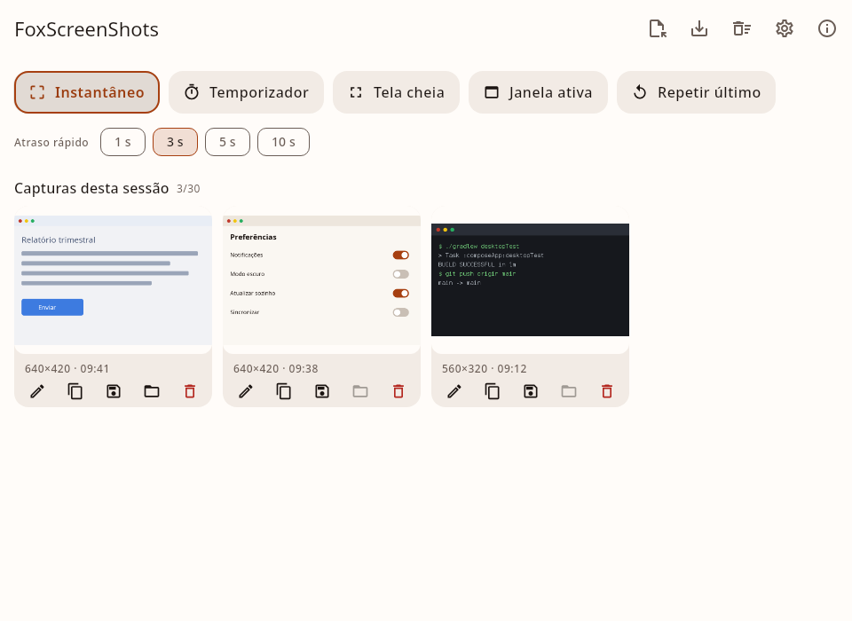
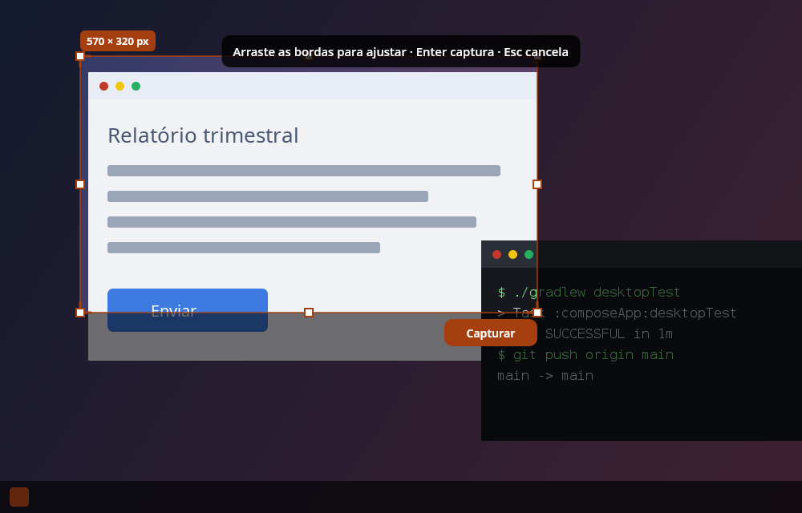
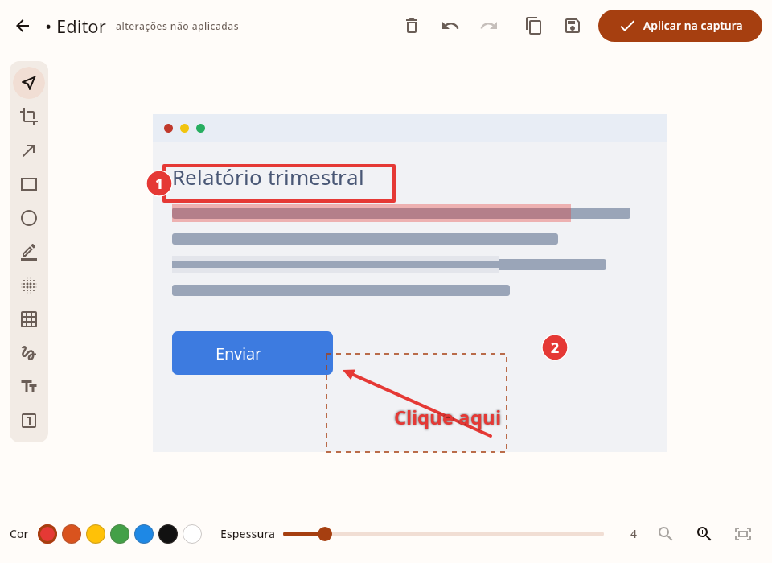
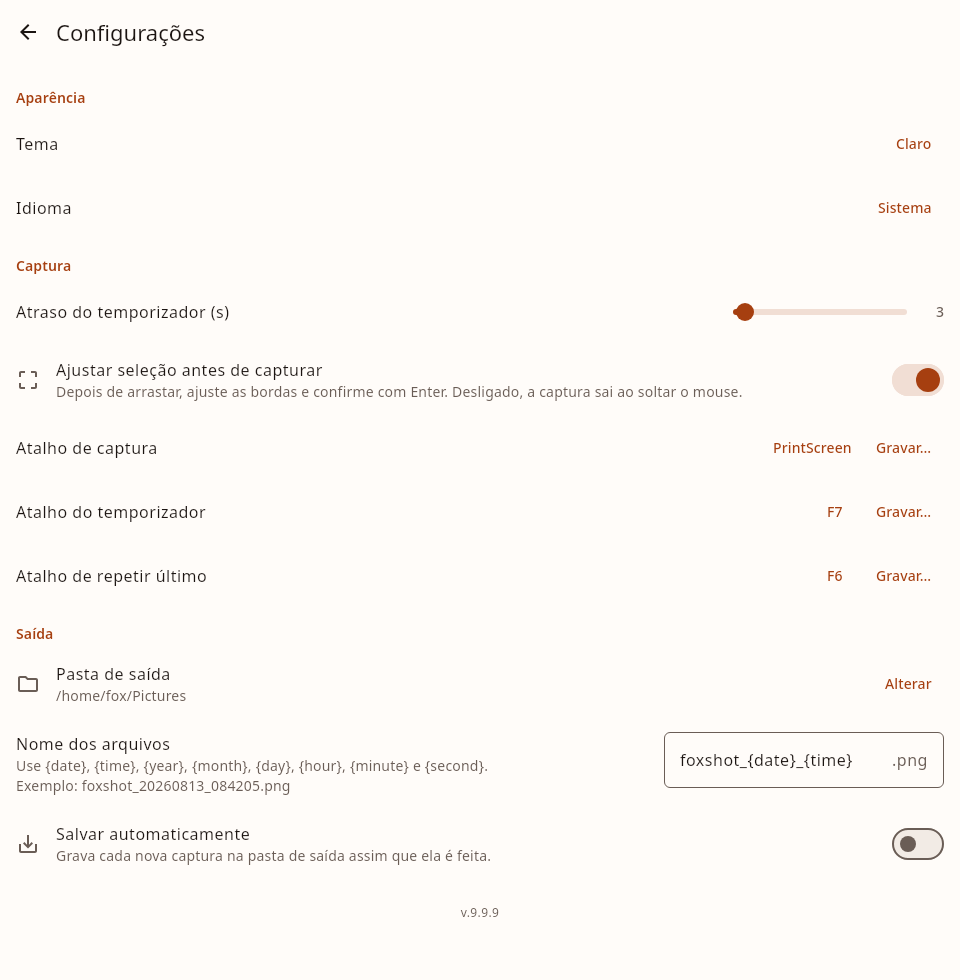
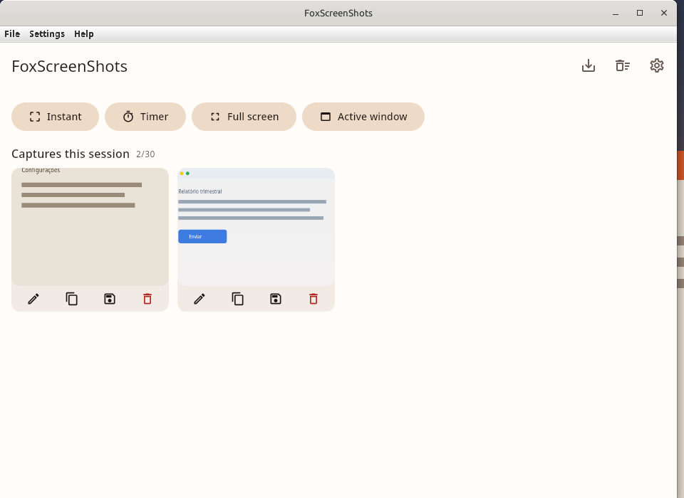
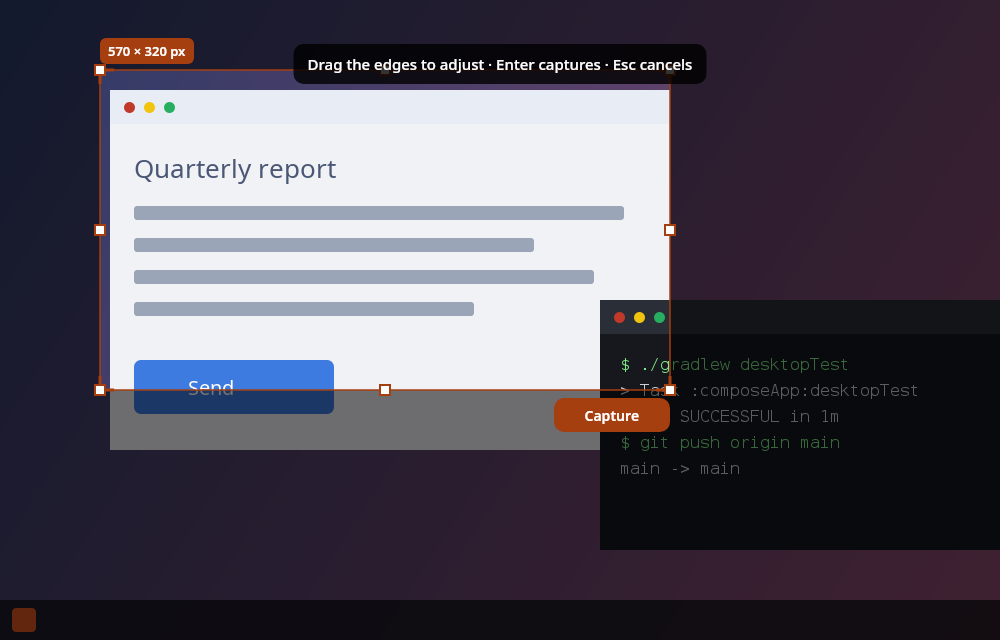
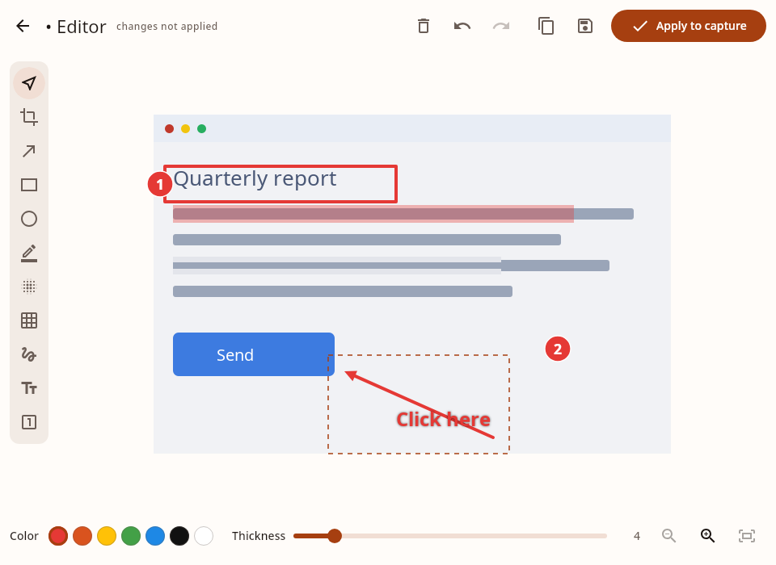
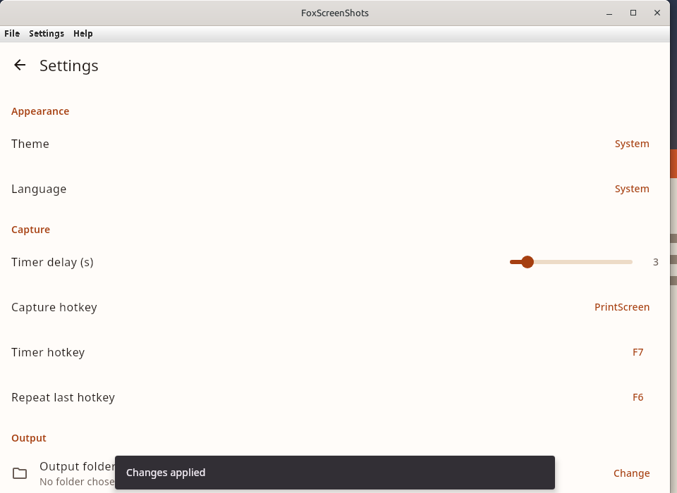

<div align="center">

# 🦊 FoxScreenShots

[](https://buymeacoffee.com/legendaryredfox)


**Captura e edição rápida de screenshots — Windows · Linux · macOS**

[](https://github.com/romulofer/FoxScreenshots/actions/workflows/ci.yml)
[](LICENSE)

Feito em Kotlin Multiplatform (Compose Multiplatform para desktop). Código
aberto sob a [Licença MIT](LICENSE).

**Português (Brasil)** · [English](#-foxscreenshots--english)

</div>

---

## O que faz

Ferramenta de desktop para capturar e anotar screenshots rapidamente.

- **Modo instantâneo** — aperte o atalho global; a tela congela e você arrasta
  um retângulo; ajuste as bordas e confirme com Enter (ou desligue o ajuste e
  a captura sai ao soltar o mouse).
- **Modo temporizador** — escolha a região antes; a foto sai depois de alguns
  segundos, dando tempo de abrir menus, dicas de ferramenta e estados de hover.
- **Tela cheia, janela ativa e repetir a última captura.**
- **Editor** — recorte, seta, retângulo/elipse, texto, marca-texto,
  desfoque/pixelagem, caneta livre e marcadores numerados. Selecionar, mover e
  excluir anotações, zoom, atalhos de teclado e desfazer/refazer.
- **Saída** — copia para a área de transferência **e** salva em PNG.
- **Nome de arquivo configurável** (`{date}`, `{time}`…), diálogo de salvar que
  lembra a última pasta e **Abrir imagem** (botão na barra superior) para anotar uma imagem existente.
- **Atrasos rápidos** (1, 3, 5, 10 s) direto na janela principal.
- **Roda na bandeja do sistema**, com atalhos globais reconfiguráveis.
- **Localizado** em português (pt-BR) e inglês (en-US).
- **Temas claro e escuro.**

> 🔒 **Privacidade:** tudo roda localmente. O FoxScreenShots **não faz nenhuma
> chamada de rede** e nunca envia o conteúdo da sua tela para lugar nenhum.

## Telas

**Janela principal** — barra de captura e a galeria da sessão:



**Seleção de região** — a tela congela, com dimensões ao vivo e lupa para
acertar a borda pixel a pixel:



**Editor** — camada de anotação não destrutiva, achatada só na exportação:



**Configurações** — tema, idioma, atraso do temporizador e atalhos:



> As imagens são geradas pelo próprio app, sobre uma área de trabalho sintética
> num servidor X virtual (xvfb).

## Situação atual

A **1.0.0** é a reescrita do app de Flutter para Kotlin Multiplatform. Funciona
no Linux/X11 (testado, inclusive com vários monitores); no Wayland a captura
passa pelo xdg-desktop-portal, sem janela ativa nem atalho global. Os backends
de Windows (GDI) e macOS (CoreGraphics) compilam e têm a CI nos dois sistemas,
mas ainda não foram exercitados em hardware real.

## Instalação

Baixe o instalador da [última release](https://github.com/romulofer/FoxScreenshots/releases/latest):

| Sistema | Arquivo |
|---|---|
| Linux (Debian/Ubuntu/Mint) | `foxscreenshots-vX.Y.Z-linux-amd64.deb` — `sudo apt install ./foxscreenshots-*.deb` |
| Windows 10/11 (64 bits) | `foxscreenshots-vX.Y.Z-windows-x64.msi` |
| macOS | `foxscreenshots-vX.Y.Z-macos.dmg` |

Os instaladores já trazem o runtime do Java: não é preciso instalar o JDK.

**Linux.** O `.deb` declara as bibliotecas que usa (X11, XTest, xkbcommon…); o
`apt` instala o que faltar. **Wayland** captura pelo `xdg-desktop-portal`: a
área de trabalho pede autorização na primeira captura. Em troca, capturar a
*janela ativa* e o *atalho global* não funcionam — o Wayland não deixa um
aplicativo saber nada sobre as janelas dos outros nem prender uma tecla do
sistema. A seleção de região continua funcionando: o quadro congelado é
encaixado dentro da janela em tela cheia.

**macOS.** Autorize o app em *Ajustes do Sistema → Privacidade e Segurança →
Gravação de Tela* (captura) e *Acessibilidade* (atalhos globais).

**Windows e macOS não são assinados digitalmente.** O SmartScreen pede *Mais
informações → Executar assim mesmo*; no macOS, abra com *clique direito →
Abrir* na primeira vez.

O app verifica o ambiente na inicialização e mostra um aviso nomeando o que
estiver faltando — ninguém fica com um botão que não faz nada em silêncio.

## Desenvolvimento

Requer o **JDK 25 ou mais novo**. O Gradle vem pelo wrapper.

```bash
./gradlew :composeApp:run                 # roda o app
./gradlew :composeApp:desktopTest         # testes de unidade e de UI
./gradlew :composeApp:packageDeb          # instalador do sistema atual (.deb / .msi via packageMsi / .dmg via packageDmg)
```

Os testes que injetam teclas e escrevem na área de transferência só rodam num
display descartável, nunca na sua sessão:

```bash
FOX_ISOLATED_DISPLAY=1 xvfb-run -a ./gradlew :composeApp:desktopTest
```

(precisa de `xvfb`, `xdotool` e `x11-apps` no Linux).

## Organização do projeto

Em resumo, em `composeApp/src/`:
`commonMain` guarda o que não depende de sistema (modelos, fluxos de captura,
editor, configurações, textos pt-BR/en-US, tema e as telas em Compose);
`desktopMain` guarda o que toca no sistema (captura por X11/portal/GDI/
CoreGraphics via JNA, Skia, bandeja, atalhos globais, área de transferência,
diálogos de arquivo); os testes ficam em `commonTest` e `desktopTest`.

## Contribuindo

Issues e PRs são bem-vindos — veja [`CONTRIBUTING.md`](CONTRIBUTING.md) para o
passo a passo. Em resumo: mantenha os dois idiomas completos, use os tokens de
tema (nada de cores cruas) e escreva testes para lógica nova. Mudanças grandes
(dependência nova, backend de captura, paleta) precisam de aval prévio: abra uma
issue antes. Vulnerabilidade de segurança? Use o
[relatório privado do GitHub](https://github.com/romulofer/FoxScreenShots/security/advisories/new) ou escreva para
rfe89@hotmail.com, em vez de abrir issue pública.

## Licença

[MIT](LICENSE) © 2026 Rômulo Fernandes Evangelista

---

<div align="center">

# 🦊 FoxScreenShots — English

**Cross-platform screenshot capture & light editing — Windows · Linux · macOS**

Built with Kotlin Multiplatform (Compose Multiplatform for desktop). Open
source under the [MIT License](LICENSE).

[Português (Brasil)](#-foxscreenshots) · **English**

</div>

## What it does

A desktop tool to capture and quickly annotate screenshots.

- **Instant mode** — hit a global hotkey; the screen freezes and you drag a
  selection to crop.
- **Timer mode** — pick the region first, then capture after a delay, so you can
  open menus, tooltips, and hover states before the shot is taken.
- **Full screen, active window, and repeat the last capture.**
- **Editor** — crop, arrow, rectangle/ellipse, text, highlight, blur/pixelate,
  freehand pen, and numbered step markers. Undo/redo.
- **Output** — copy to clipboard **and** save as PNG.
- **Runs in the system tray** with rebindable global hotkeys.
- **Localized** in Portuguese (pt-BR) and English (en-US).
- **Light & dark themes.**

> 🔒 **Privacy:** everything runs locally. FoxScreenShots makes **no network
> calls** and never uploads your screen content anywhere.

## Screens

**Main window** — capture toolbar and the session gallery:



**Region selection** — the screen freezes, with live dimensions and a magnifier
for pixel-precise edges:



**Editor** — a non-destructive annotation layer, flattened only on export:



**Settings** — theme, language, timer delay and hotkeys:



> The images are generated by the app itself, over a synthetic desktop on a
> virtual X server (xvfb).

## Status

**1.0.0** is the rewrite of the app from Flutter to Kotlin Multiplatform. It
works on Linux/X11 (tested, multiple monitors included); on Wayland capture goes
through xdg-desktop-portal, without active-window capture or the global hotkey.
The Windows (GDI) and macOS (CoreGraphics) backends compile and have CI on both
systems, but have not been exercised on real hardware yet.

## Install

Download the installer from the [latest release](https://github.com/romulofer/FoxScreenshots/releases/latest):

| System | File |
|---|---|
| Linux (Debian/Ubuntu/Mint) | `foxscreenshots-vX.Y.Z-linux-amd64.deb` — `sudo apt install ./foxscreenshots-*.deb` |
| Windows 10/11 (64-bit) | `foxscreenshots-vX.Y.Z-windows-x64.msi` |
| macOS | `foxscreenshots-vX.Y.Z-macos.dmg` |

The installers bundle the Java runtime: no JDK needed.

**Linux.** The `.deb` declares the libraries it uses (X11, XTest, xkbcommon…);
`apt` installs whatever is missing. **Wayland** captures through
`xdg-desktop-portal`: the desktop asks for permission on the first capture. In
exchange, *active window* capture and the *global hotkey* do not work there —
Wayland lets an app know nothing about other windows and grab no system-wide
key. Region selection still works: the frozen frame is fitted inside the
fullscreen overlay.

**macOS.** Allow the app under *System Settings → Privacy & Security → Screen
Recording* (capture) and *Accessibility* (global hotkeys).

**Windows and macOS builds are not code-signed.** SmartScreen asks for *More
info → Run anyway*; on macOS, *right click → Open* the first time.

The app checks its environment at startup and shows a banner naming whatever is
missing, so users are never left with a button that silently does nothing.

## Development

Requires **JDK 25 or newer**. Gradle comes through the wrapper.

```bash
./gradlew :composeApp:run                 # run the app
./gradlew :composeApp:desktopTest         # unit and UI tests
./gradlew :composeApp:packageDeb          # installer for this OS (.deb / packageMsi for .msi / packageDmg for .dmg)
```

The tests that inject keystrokes and write to the clipboard only run on a
throwaway display, never on your session:

```bash
FOX_ISOLATED_DISPLAY=1 xvfb-run -a ./gradlew :composeApp:desktopTest
```

(needs `xvfb`, `xdotool` and `x11-apps` on Linux).

## Project layout

In short, under `composeApp/src/`: `commonMain`
holds everything that does not depend on the OS (models, capture flows, editor,
settings, pt-BR/en-US strings, theme, and the Compose screens); `desktopMain`
holds what touches the OS (X11/portal/GDI/CoreGraphics capture through JNA,
Skia, tray, global hotkeys, clipboard, file dialogs); tests live in
`commonTest` and `desktopTest`.

## Contributing

Issues and PRs welcome — see [`CONTRIBUTING.md`](CONTRIBUTING.md) for the
walkthrough. In short: keep both locales complete, use theme tokens (no raw
colors), and add tests for new logic. Larger changes (new dependency, capture
backend, palette) need prior approval: open an issue first. Found a security
vulnerability? Use GitHub's
[private vulnerability reporting](https://github.com/romulofer/FoxScreenShots/security/advisories/new) or email
rfe89@hotmail.com instead of opening a public issue.

## License

[MIT](LICENSE) © 2026 Rômulo Fernandes Evangelista
